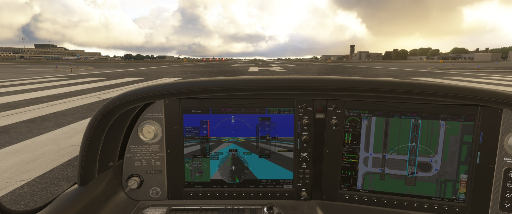

# SR20 Realism Mod

**A Cirrus SR20 G6 (Perspective+) for Microsoft Flight Simulator 2024**, built by a pilot who flies a real one. It turns
the sim's own SR22T into an SR20 with the POH's engine, weights, fuel and systems, and makes the avionics behave like
the real Perspective+: TAWS-B, SurfaceWatch, ESP, a working circuit breaker panel, and an Instructor Station for
failures and approach practice.

**[Download the latest version](https://github.com/wazooda/SR20-Realism-Mod/releases/latest)** ·
**[User manual](https://wazooda.github.io/SR20-Realism-Mod/)** ·
**[Video](https://youtu.be/H8mZQf73w0s)**

## From the Author

I made this solely for myself to get as close to my actual SR20 G6 for the original purpose of trying to achieve as
close a parity to my aircraft for training purposes. It ended up taking on a bit of a life of its own once my IRL
airplane was struck on the ramp last month while parked (a Citation 550 taxied into it taking out the pitot tube and
the aileron) thus grounding me until the New Year. So I decided to expand the project to an approach and failure
generator to keep my IFR skill sharp and a way to test my ability to diagnose failures. Then I decided to make the
stock Perspective+ work almost EXACTLY like my aircraft by adding TAWS-B and Surfacewatch. And then Electronic
Stability Control. And then Obstacle databases for TAWS-B. And then REAL taxiways loaded from online. And
then.........

**What this is NOT:** A completely accurate flight model. The truth is, no sim aircraft flies like the real thing, but
the SR22T is SO off the mark for my SR20 that it was distracting to me. I did a bunch of flight testing with the POH
numbers as the basis.... and it's good enough for my purposes... but maybe not yours. Also, besides the upgrades to
the avionics, there are NO cosmetic enhancements. I use the stock SR22T and then I pretend I don't see the anti-ice,
oxygen or weird placarding. I got over it quickly. However, if any artists out there want to take it on, I'd love to
assist!

Hope you get some use out of it. And if you have a RealSimGear Cirrus yoke, I did my best to simulate the forces to
override the autopilot manually and how ESP takes over the yoke if you are outside the limits.

Enjoy!

Wazooda

## What's in it

- **SR20 engine, fuel and performance** from the POH: IO-390, 215 hp, 56 gal usable, 3,150 lb, SR20 engine and fuel
  pages, SR20 CAS alerts, and a rewired SR20 electrical system with modelled bus voltages
- **TAWS-B** on real terrain with the FAA obstacle file: forward-looking terrain and obstacle alerts, excessive descent,
  negative climb, premature descent and the 500 ft callout, with impact areas on the maps and synthetic vision
- **SurfaceWatch and SafeTaxi**: the PFD runway box, Check Runway, Runway Too Short and Taxiway alerts, and airport maps
  with real taxiway names (50 included, any other airport on demand)
- **ESP** and **GFC 700 speed protection** (MAXSPD, MINSPD, underspeed protection)
- **Glide range ring** over real terrain, and the fuel range ring
- A **circuit breaker panel** that acts on the real circuits
- The **Instructor Station**: arm failures by phase of flight (some hidden or random), get scored against the POH
  procedure, and set up any approach in a few clicks from vectors, a fix or the ramp, with live, overcast or random
  weather
- **ForeFlight to G1000**: send your route from the iPad to the MFD over home Wi-Fi, the way FlightStream does in the
  airplane, plus the sim's position on ForeFlight's moving map
- **RealSimGear Cirrus yoke** force feel, autopilot override and the ESP push
- Perspective+ voice alerts and a long list of G1000 and autopilot behaviours matched to the real unit

Everything, with how to turn each feature on and off, is in the **[user manual](https://wazooda.github.io/SR20-Realism-Mod/)**.

## Install

1. Download `SR20RealismMod-<version>-installer.zip` from the
   **[latest release](https://github.com/wazooda/SR20-Realism-Mod/releases/latest)** and unzip it.
2. Close the sim and run `SR20RealismMod-Setup-<version>.exe`. It finds your Community2024 folder and installs the
   aircraft and the SR20 Companion for your Windows user (no administrator rights).
3. Start the sim and pick **Cirrus SR20 G6 (SR20 Realism Mod)**.

The installer is not code-signed: if Windows says "Windows protected your PC", click **More info**, then
**Run anyway**. If Windows asks about network access, allow **Private networks** only. The `manual.zip` is the same
mod for installing by hand. Full steps: [Installing and first flight](https://wazooda.github.io/SR20-Realism-Mod/install.html).

**Requirements:** Microsoft Flight Simulator 2024 with the stock Cirrus SR22T (tested on Steam), and Windows for the
SR20 Companion, the small helper program that supplies terrain, airport maps and the iPad link.

Also on flightsim.to (search for "SR20 Realism Mod").

## Questions and problems

Open an [issue](https://github.com/wazooda/SR20-Realism-Mod/issues) or comment on the flightsim.to page. Please say which
sim version (Steam or Microsoft Store) you use and what you were doing when the problem appeared. The
[troubleshooting chapter](https://wazooda.github.io/SR20-Realism-Mod/companion-troubleshooting.html) covers the common
ones.

## Licence and credits

- Aircraft package: CC BY-NC 4.0 for the parts made for this mod. The base aircraft, 3D model and G1000 NXi avionics
  are the stock MSFS 2024 Cirrus SR22T by Microsoft, Asobo and Working Title; the mod's avionics files are modified
  copies of its plugins, and the mod needs the stock aircraft installed.
- SR20 Companion: AGPL-3.0, source at [wazooda/SR20-Companion](https://github.com/wazooda/SR20-Companion).
- Manual text and screenshots: CC BY-NC 4.0.
- Terrain: Copernicus DEM GLO-90 (© DLR e.V. / Airbus Defence and Space, provided under COPERNICUS by the EU and ESA).
  Obstacles: FAA Digital Obstacle File. Taxiway names: © OpenStreetMap contributors (ODbL).

Not affiliated with or endorsed by Cirrus Aircraft, Garmin, ForeFlight, RealSimGear, Microsoft or Asobo. For flight
simulation only, not for real-world flight training.
